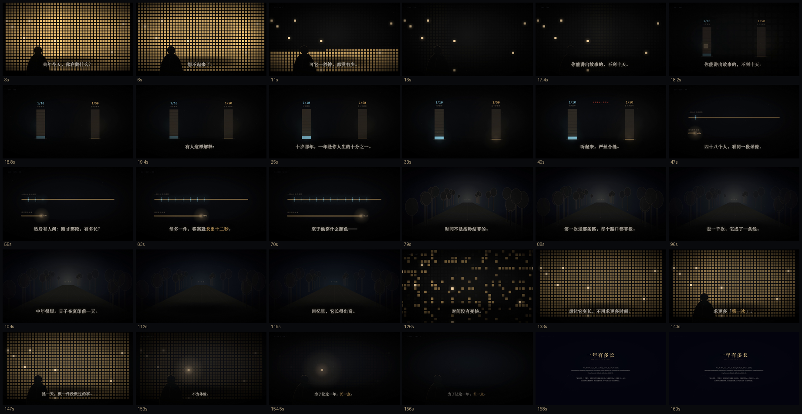

# knowledge-video

把一句话题，变成一条能发的知识短片——**无旁白、字幕驱动、画面自己说话**。

一个 Agent Skill：给它「做一期关于 X 的视频」，它吐出研究、文案、分镜、成片、配乐、三尺寸封面、三平台标题。



---

## 这不是「AI 生成视频」

市面上多数工具解决的是**生成**：给提示词，出画面。

这个 skill 解决的是**规格**：一条 161 秒的知识短片，句子该多长、镜头该动多少、什么时候该把声音掐掉、封面该用哪个画面。

它不替你写，它逼你按一个已经被验证过的结构来写。

---

## 它怎么来的

从同类型作品里逐帧逆向出来的。

- 采集了一批同类型的高传播作品
- 逐条下载、抽帧、OCR 出字幕文本
- 量化了时长、每秒字数、字幕停留、场景切换、标题句式
- 然后写了一条同题材的片子，逐段对比、返工

结论不是「模仿他的风格」，而是：

> **这个长度的知识短片，有一条可复用的规格线。**

参考数据（样本中位数）：

| 指标 | 数值 |
|---|---|
| 时长 | 161 秒 |
| 每秒字数 | 3.1 |
| 单条字幕停留 | 3.0 秒 |
| 硬切 | ≈ 0（全部溶解） |
| 字幕字号 | 66px 宋体 |

---

## 三条最硬的规则

### 1. 每一句里，至少有一个能想象的画面

```
✗ 答案的长短，和他们记住了几件事高度相关。
✓ 有人记得三件，有人记得八件。
```

写完逐句问：这句能不能拍成画面？不能就重写。

### 2. 镜头全片都在动

```ts
const push = 1 + 0.05 * at(t, 0, 18);  // 18 秒推 5%，看不出来但画面不死
```

静止二十秒的画面叫幻灯片，不叫电影。

### 3. 静音是最强的一刀

在关键转场处把整条音轨压到 −36 dB，持续 0.9 秒，然后一个低频 boom 落地。

比任何音效都响。全片只用一次。

---

## 快速开始

```powershell
# 1. 装 skill（复制到你的 skills 目录）
git clone https://github.com/<you>/knowledge-video-skill.git
Copy-Item .\knowledge-video-skill "$env:USERPROFILE\.claude\skills\knowledge-video" -Recurse

# 2. 建一个 Remotion 项目
npm create video@latest my-video

# 3. 一条命令铺好素材
cd knowledge-video-skill
.\scaffold.ps1 -Project "C:\path\to\my-video" -Id "Entropy" -Name "entropy" -Duration 161
```

脚手架会复制组件、生成 161 秒的事件化配乐，并打印 `Root.tsx` 的注册片段。

之后只剩三件手工活：改字幕、改封面文案、注册 Composition。

---

## 目录

```
SKILL.md                七步流水线 + 反模式 + 验收清单
scaffold.ps1            一条命令建项目

references/
  writing.md            文案规则（八组正反对照）
  structure.md          161 秒六幕时间轴
  visuals.md            五条摄影原则
  sound.md              事件化配乐
  publishing.md         三平台封面与标题
  setup.md              环境与命令（含 Windows TEMP 坑）

assets/
  Kit.tsx               片名卡 / 片尾卡 / 字幕系统
  YearWorld.tsx         五幕场景模板（全景墙 / 刻度柱 / 切片 / 路 / 回望）
  Cover.tsx             三尺寸封面组件，四种母题
  score_episode.py      事件化配乐（静音、坠落、刻度、末音）
  synth.py              合成器库（无采样，纯数学生成）
  grain.png             胶片颗粒
```

---

## 示例产物

| | |
|---|---|
| [16:9 封面](examples/cover-16x9.png) | B站 / 公众号 |
| [9:16 封面](examples/cover-9x16.png) | 抖音 / 快手 |
| [3:4 封面](examples/cover-3x4.png) | 小红书 |
| [分镜联络表](examples/storyboard.png) | 29 格，含两个镜头运动 |

---

## 反模式

都是踩过的坑，写进 skill 防止重犯：

| 别做 | 为什么 |
|---|---|
| 用「高度相关」「机制」「维度」 | 观众脑子里没有画面，是论文不是人话 |
| 平铺直叙一张卡片换一张卡片 | 那是幻灯片，不是电影 |
| 结尾给建议 | 换成一个问句或一个画面 |
| 字幕压在亮画面上 | 必须加柔和暗底，否则读不清 |
| 配乐从头铺到尾 | 没有动态就没有情绪 |
| 封面另起一套视觉 | 观众对不上片子 |

---

## 诚实边界

- 规格数据来自**同类型作品的一个有限样本**，不是普适真理。
- 「每句一个画面」是编辑判断，无法自动校验。
- 画面组件是 SVG 拼的伪 3D，**做不到**真 3D 渲染的景深与体积光。
- 页面里的数字都标注了出处；skill 要求使用者在片尾卡交代样本量与边界。

如果你的题材不是「科学 × 个人处境 × 反直觉」，这套规格不一定适用。

---

## 环境

- Node 18+，Remotion 4.x
- Python 3.10+（配乐用 numpy）
- ffmpeg（抽帧、验证音量）
- Windows / macOS / Linux

Windows 有一个致命坑：系统会清理 `%TEMP%`，导致渲染中途 `write EOF`。见 `references/setup.md`。

---

## License

MIT

